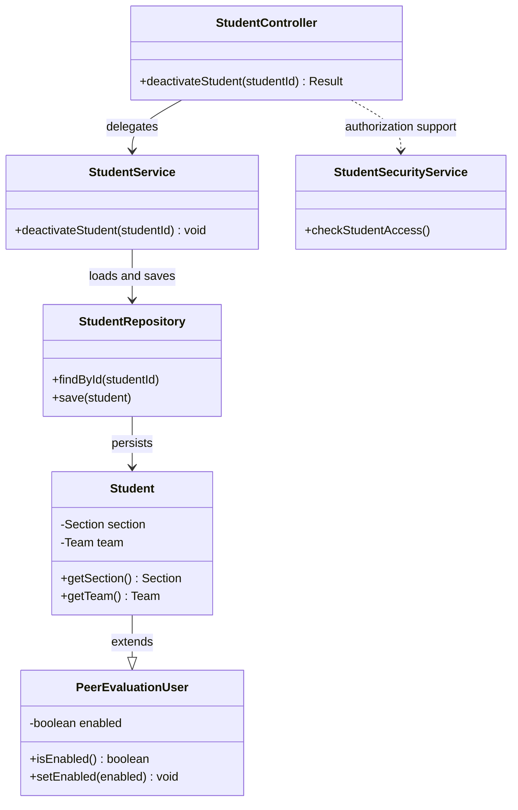
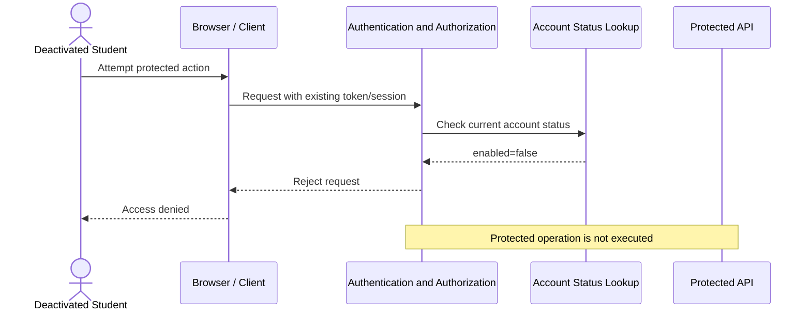

# Student Design

> **Use case:** UC-STU-deactivate-student  
> **Related requirement:** FR-SEC-active-account  
> **Status:** Proposed design for Part 1; implementation deferred to Part 2.

**References:** [Use Cases](../requirements/use-cases.md) · [Business Rules](../requirements/business-rules.md) · [Software Requirements Specification](../requirements/software-requirements-specification.md) · [Architectural Design](architectural-design.md)

## 1. Overview

This design supports deactivating a student account without deleting the student or their historical academic work.

An authorized course admin or instructor selects a student, reviews the student's details, and confirms deactivation. The system changes the student's existing `enabled` property from `true` to `false`.

After deactivation:

- The student account remains stored.
- The student's existing team and section assignments remain unchanged.
- Previously submitted weekly activity reports and peer evaluations remain preserved.
- The student cannot access protected application functions, including through a previously issued token or active session.
- The student cannot submit or edit future weekly activity reports or peer evaluations.
- Authorized users retain access to historical records according to existing visibility rules.

The feature follows the existing Spring backend structure and reuses the application's student entity, repository, standard `Result` response format, and authorization conventions.

## 2. Components and Classes

The existing backend contains `StudentController`, `StudentService`, `StudentRepository`, `StudentSecurityService`, `Student`, and `PeerEvaluationUser`.

### Component responsibilities

| Component | Responsibility |
|---|---|
| Student Management UI | Display student details, request confirmation, and show success or error feedback. |
| `StudentController` | Expose the proposed deactivation endpoint and return the standard `Result` response. |
| Authorization layer | Verify that the requester is a permitted course admin or instructor for the student's course or section. |
| `StudentService` | Perform deactivation, validate current account status, and ensure transactional consistency. |
| `StudentRepository` | Retrieve and persist the student entity. |
| `Student` | Preserve existing student identity, section, and team relationships. |
| `PeerEvaluationUser` | Supply the existing `enabled` account-status property. |
| Authentication/security layer | Reject protected requests from disabled accounts, including requests using existing sessions or tokens. |

### Proposed class diagram



**Note:** `deactivateStudent` is a proposed new operation, not an existing method. The authorization method in the diagram represents a responsibility, not a verified existing method signature. Part 2 must reuse the actual security interfaces and conventions in the repository.

## 3. Sequence Diagrams

### 3.1 Main success scenario

```mermaid
sequenceDiagram
    actor Actor as Course Admin / Instructor
    participant UI as Student Management UI
    participant C as StudentController
    participant A as Authorization Layer
    participant S as StudentService
    participant R as StudentRepository
    participant DB as Database

    Actor->>UI: Select student
    UI->>C: GET /students/{studentId}
    C->>S: findStudentById(studentId)
    S->>R: Retrieve student
    R-->>S: Student details
    S-->>C: Student
    C-->>UI: Student details
    UI-->>Actor: Display details and deactivate option

    Actor->>UI: Confirm deactivation
    UI->>C: PATCH /students/{studentId}/deactivate
    C->>A: Check role and course/section permission
    A-->>C: Authorized
    C->>S: deactivateStudent(studentId)
    S->>R: findById(studentId)
    R->>DB: Load student
    DB-->>R: Student record
    R-->>S: Student
    S->>S: Verify enabled is true
    S->>S: setEnabled(false)
    S->>R: save(student)
    R->>DB: Persist account status
    DB-->>R: Saved
    R-->>S: Success
    S-->>C: Deactivation complete
    C-->>UI: 200 OK with Result
    UI-->>Actor: Show success confirmation
```

### 3.2 Exceptions and alternate flows

```mermaid
sequenceDiagram
    actor Actor as Course Admin / Instructor
    participant UI as Student Management UI
    participant C as StudentController
    participant A as Authorization Layer
    participant S as StudentService
    participant R as StudentRepository

    alt Actor cancels confirmation
        Actor->>UI: Cancel
        UI-->>Actor: Return without changes
        Note over UI,C: No deactivation request is sent
    else Actor confirms
        UI->>C: PATCH /students/{studentId}/deactivate
        C->>A: Validate permissions
        alt Unauthorized
            A-->>C: Denied
            C-->>UI: 403 Forbidden
        else Authorized
            A-->>C: Allowed
            C->>S: deactivateStudent(studentId)
            S->>R: findById(studentId)
            alt Student not found
                R-->>S: No matching student
                S-->>C: Not found
                C-->>UI: 404 Not Found
            else Student already inactive
                R-->>S: Student enabled=false
                S-->>C: Already inactive
                C-->>UI: 409 Conflict
            else Persistence fails
                R-->>S: Database error
                Note over S,R: Transaction rolls back
                S-->>C: Operation failed
                C-->>UI: Server error
            end
        end
    end
```

### 3.3 Previously authenticated student



The last diagram is a required security behavior. The implementation must verify that the existing authentication configuration checks the current account status on protected requests rather than trusting a previously issued token alone.

## 4. API Contract

### Proposed endpoint

`PATCH ${api.endpoint.base-url}/students/{studentId}/deactivate`

The existing `StudentController` is mapped to `${api.endpoint.base-url}/students`. The proposed endpoint adds a new route beneath that base path.

| Property | Design |
|---|---|
| HTTP method | `PATCH` |
| Path | `/students/{studentId}/deactivate`, beneath the configured API base URL |
| Path parameter | `studentId`: integer identifier |
| Request body | None |
| Authorized caller | Course admin with applicable course authority, or instructor assigned to the student's section |
| Success | `200 OK` with the application's standard `Result` envelope |
| `403 Forbidden` | Requester lacks the required role or course/section permission |
| `404 Not Found` | Student identifier does not exist |
| `409 Conflict` | Student is already inactive |
| Server error | Persistence failure; transaction must roll back |

The success response should confirm the operation without exposing credentials or unnecessary student data. Exact `Result` factory methods and error mappings will be selected according to existing backend conventions during Part 2.

### Existing endpoints

The existing controller provides:

- `GET /students/{studentId}` to retrieve student details.
- `PUT /students/{studentId}` to update student information.
- `DELETE /students/{studentId}` to delete a student.

Deactivation uses a separate endpoint to distinguish disabling an account from updating general profile data or deleting a record.

## 5. Data Model

### Existing representation

`Student` extends `PeerEvaluationUser`.

The existing parent class contains:

```java
private boolean enabled;

public boolean isEnabled() {
    return enabled;
}

public void setEnabled(boolean enabled) {
    this.enabled = enabled;
}
```

The existing `Student` entity also contains references to `Section` and `Team`.

### Proposed state change

| Field or relationship | Before | After deactivation |
|---|---|---|
| `PeerEvaluationUser.enabled` | `true` | `false` |
| Student identity | Existing | Unchanged |
| Student section | Existing assignment | Unchanged |
| Student team | Existing assignment | Unchanged |
| Historical weekly reports | Stored | Preserved |
| Historical peer evaluations | Stored | Preserved |
| Protected application access | Allowed when otherwise authorized | Denied |

No new status column, entity, or table is proposed. Part 2 must confirm that `enabled` is mapped and persisted correctly through the existing JPA inheritance strategy.

The update must be transactional. Deactivation must not cascade into deletion of team membership, reports, evaluations, or other historical records.

## 6. Key Design Decisions and Rejected Alternatives

### Decision 1: Soft deactivation using `enabled`

**Chosen:** Set the existing `PeerEvaluationUser.enabled` property to `false`.

**Rejected:** Delete the student record.

**Reason:** Deletion could destroy or disrupt historical attribution and relationships. The use case requires account access to end while historical data remains intact.

### Decision 2: Dedicated PATCH endpoint

**Chosen:** Introduce `PATCH /students/{studentId}/deactivate`.

**Rejected:** Reuse `DELETE /students/{studentId}` or require clients to send a full student object to the general `PUT` endpoint.

**Reason:** A dedicated operation expresses intent clearly, prevents accidental deletion, and keeps lifecycle authorization separate from general profile editing.

### Decision 3: Preserve team and section relationships

**Chosen:** Keep the student's existing team and section assignments.

**Rejected:** Automatically remove the student from the team.

**Reason:** Preserving the relationships maintains historical attribution of reports, evaluations, and participation. Account access is controlled through account status, not by deleting relationships.

### Decision 4: Check authorization before mutation

**Chosen:** Validate the requester's role and applicable course/section scope before changing the account.

**Rejected:** Allow any authenticated user to deactivate students.

**Reason:** Deactivation is a privileged operation affecting another user's access. Authorization must prevent changes outside the requester's permitted scope.

### Decision 5: Reject existing sessions after deactivation

**Chosen:** Enforce the disabled-account rule for protected requests even when a token or session was issued before deactivation.

**Rejected:** Check `enabled` only when the student logs in.

**Reason:** Login-only checks would allow a previously authenticated student to continue using protected functionality after deactivation.

### Decision 6: Handle repeated deactivation explicitly

**Chosen:** Return a conflict response when the account is already inactive.

**Rejected:** Silently treat every repeated deactivation as a new success.

**Reason:** Explicit feedback tells the actor that no state transition occurred and supports the documented exception flow.

### Decision 7: Transactional update

**Chosen:** Perform the status change within a transaction.

**Rejected:** Allow partial updates or delete related records during failure recovery.

**Reason:** A persistence error must not leave an inconsistent student account or alter historical data.

## 7. Reuse and Cross-Cutting Concerns

**Authentication:** Reuse the existing security infrastructure. Verify how the application loads account details and how the `enabled` flag affects authentication and authorization.

**Authorization:** Reuse established role and section-scoped access checks. A course admin or instructor must not be allowed to deactivate students outside their authority.

**Persistence:** Reuse `StudentRepository` and the existing JPA entity mapping. Avoid a new database migration unless inspection reveals a missing persisted account-status field.

**Response handling:** Use the application's standard `Result` envelope and existing exception-handling conventions.

**Historical data:** Preserve submitted reports, peer evaluations, and student-team relationships. Existing visibility rules continue to apply to authorized users.

**UI confirmation:** The client must ask for confirmation before sending the deactivation request. Cancellation must not cause any backend mutation.

**Security enforcement:** Disabled students must be prevented from submitting or editing reports and evaluations through backend endpoints, not merely by hiding UI controls.

## 8. Planned Tests

| Use case or exception | Test level | Expected assertion |
|---|---|---|
| Authorized main success | Integration | Authorized request succeeds and `enabled` becomes `false`. |
| Course admin authorization | Integration | Authorized course admin can deactivate an applicable student. |
| Instructor authorization | Integration | Assigned instructor can deactivate a student in the permitted section. |
| Unauthorized actor | Integration | Request is denied; `enabled` remains unchanged. |
| Wrong course or section | Integration | Request is denied without changing the student. |
| Student not found | Integration | Appropriate not-found response; no data changed. |
| Already inactive | Unit/integration | Conflict response; no additional state change. |
| Cancellation | UI/unit | No deactivation API request is sent. |
| Persistence failure | Integration | Transaction rolls back and no partial update remains. |
| Team membership preservation | Integration | Student remains associated with the original team. |
| Section preservation | Integration | Student retains the original section. |
| Historical weekly reports | Integration | Existing reports remain stored and correctly associated. |
| Historical peer evaluations | Integration | Existing evaluations remain stored and correctly associated. |
| Existing session or token | Security integration | Disabled student cannot access protected endpoints. |
| Future report submission | Security integration | Disabled student cannot submit or edit weekly reports. |
| Future evaluation submission | Security integration | Disabled student cannot submit or edit peer evaluations. |
| Other active students | Regression | Deactivation does not disrupt other students' access or records. |

Existing test files include `StudentIntegrationTest.java` and `StudentServiceTest.java`. Part 2 should extend these tests and add security-focused tests where appropriate.

## 9. Traceability

| Requirement or use case | Design element | Planned verification |
|---|---|---|
| `UC-STU-deactivate-student` | Deactivation API, service operation, and main sequence | Authorized deactivation integration test |
| `FR-SEC-active-account` | `enabled` status and protected-request enforcement | Existing-session security test |
| `BR-student-lifecycle` | Soft deactivation and preserved team assignment | Team and historical-data preservation tests |
| Section-scoped access rules | Authorization layer | Authorized and unauthorized instructor tests |
| Evaluation and submission rules | Disabled-account restrictions | Future submission and editing denial tests |

The repository's central `docs/traceability.md` must also be updated to link this design and mark the use case as **📐 Designed**.

## 10. Open Questions and Implementation Risks

1. Confirm the exact JPA mapping of `PeerEvaluationUser.enabled` and whether the existing schema already persists it.
2. Confirm the application's standard `Result` response and exception mapping conventions.
3. Confirm the appropriate authorization manager or security service for course-admin and instructor section-scoped access.
4. Confirm whether existing JWT/session processing reloads account status on every protected request. If not, Part 2 must add enforcement.
5. Confirm how report and peer-evaluation endpoints enforce account status, including write operations.
6. Confirm the UI location for the deactivation action and its confirmation dialog.
7. Confirm whether the assignment expects any notification beyond the visible success confirmation.

These are implementation verification items, not reasons to add new entities or expand the feature's scope during Part 1.

## 11. Implementation Boundary

This document specifies the design only.

**Part 1:** Complete the requirements, business rules, design diagrams, API contract, decisions, tests, traceability, and design pull request.

**Part 2:** After the design is reviewed and merged, create a fresh implementation branch from `main`, implement the endpoint and security behavior, add tests, and follow the assignment's implementation and mutation-testing instructions.